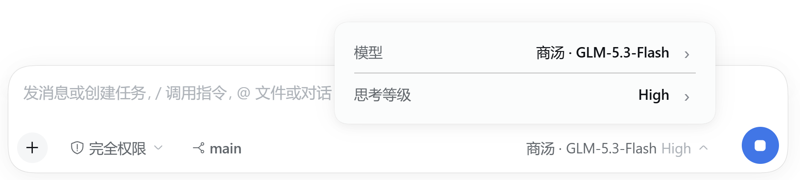
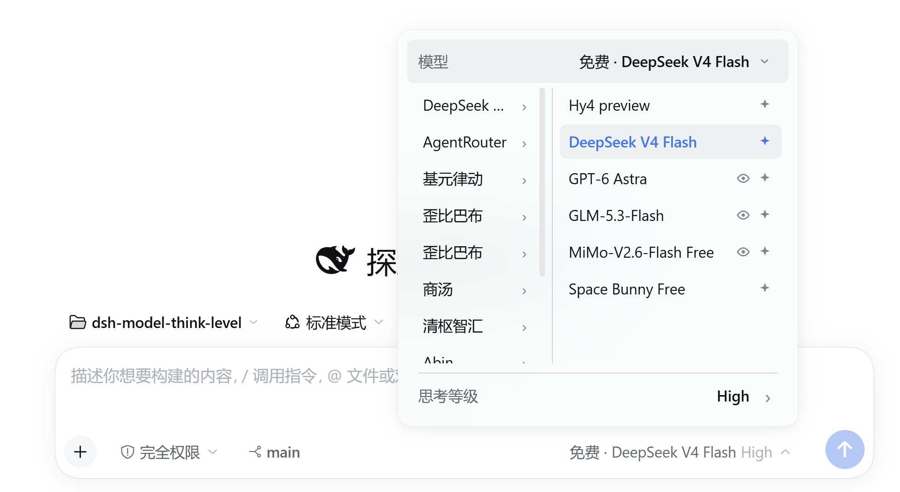
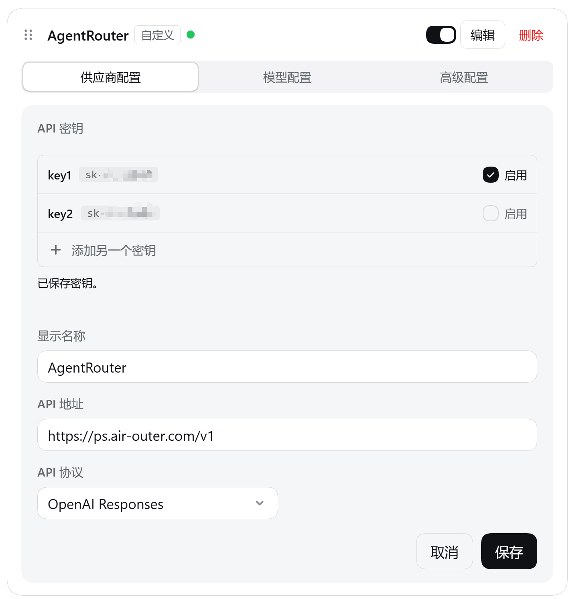
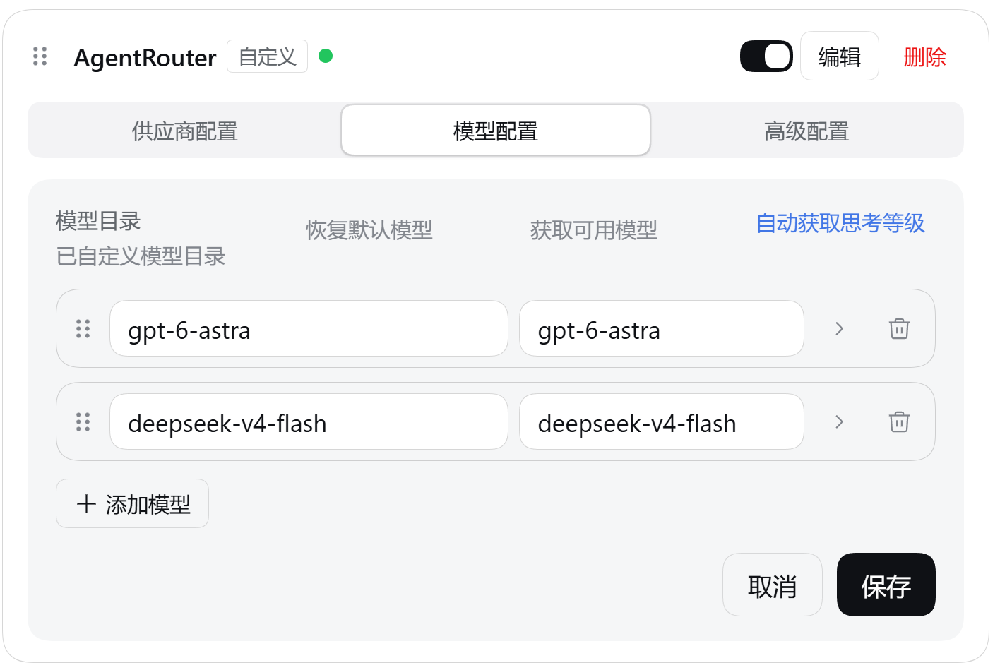
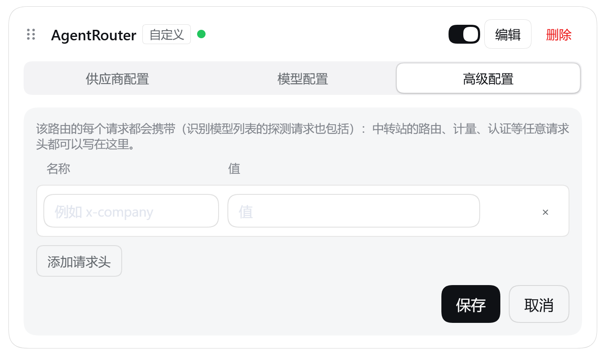

# DSH Model Think Level

DSH 的第三方模型补齐思考等级：在官方 Models 页每个模型行注入 Thinking 开关和强度/模态编辑器（插件编辑器所在的行会隐藏官方自带的「推理等级」编辑区，同一个字段只留一份控件），在输入框模型菜单加供应商→模型选择器、视觉徽章与等级行，并带搜索、拖拽排序、供应商启用开关；以及按路由接管请求头与 user-agent。

## 模型选择器

- 每个模型行右侧会显示已声明的上下文窗口（如 `128K`、`1M`，留空则不显示），取自模型上配置的「上下文窗口」字段；该字段与「最大输出」都支持 `K`/`M`/`B`/`T` 简写（如 `200K`、`1M`），也接受纯数字与千分位写法。
- 输入框的模型切换器只列**对话模型**：被标记为「生图」的模型不再出现在切换器里（供应商计数也不含它们）。生图由对话模型调用插件的原生工具完成——见下文「生图的方式」。

## 供应商配置

### 余额展示

供应商卡的「API 地址」下方、「更多端点」展开区里多了一行**余额**：填写一个只读的余额接口地址（`http(s)://…`）后，该供应商在模型页列表中的**启用开关前**会显示「余额 12.34」。没有填写这一行的供应商不显示余额，也不预留位置；清空地址即撤下展示。

- 请求由宿主发起（浏览器直接请求会受 CORS 限制），并带上该路由密钥列表中的**第一把密钥**：OpenAI 系协议用 `Authorization: Bearer`，Anthropic 系协议用 `x-api-key`。同一供应商有多把密钥时只查第一把，其余不请求。请求超时 30 秒，且不跟随重定向，密钥只会发往填写的地址本身。
- 地址可以为空；空值或非 http(s) 地址不会被保存。地址保存在插件自己的 `key-index.json` 的 `balances` 字段里，与协议地址互不覆盖，改完立即生效、无需重启。
- 响应支持 JSON 或纯数字。JSON 会按键名识别余额：`balance`、`total_balance`、`available_balance`、`remaining`、`total_available`、`credit`/`credits`、`amount`、`left`、`remain`、`*_quota` 等（大小写、下划线、连字符不敏感），同层的 `currency`/`unit` 用来决定 `$`/`¥` 等符号；OpenRouter 风格的 `total_credits` / `total_usage` 会按两者之差计算。识别不到余额时按读取失败处理，不显示金额。
- **只在打开模型页时读取，不轮询**：每次打开模型页、每个供应商读取一次；停留在页面上不会反复请求，重新打开页面才会再读一次；在配置卡里改完地址会立即重读。
- 读取失败（超时、接口报错、或响应里认不出余额）时**继续显示上一次成功读取的金额**；只有从未成功过的供应商才显示「余额 —」，悬停可看到宿主返回的原因。完全没有配置地址的供应商仍然什么都不显示。
- 余额后面的**刷新图标**可以随时手动重取这一家的余额：刷新期间保留当前金额并转动图标；失败时仍沿用上一次成功读取的值。

### 输入模态与生图

模型行的「输入模态」有三档：**文本**、**图片**、**生图**。三档互斥——勾选「生图」即把模型标记为图像生成模型（写入模型行专属的 `inputImageGen` 标记，同时清除文本/图片声明），该标记让插件在生成配置里登记这个模型，同时把该模型从输入框的切换器里隐藏；勾选文本或图片则回到普通对话模型并清除生图标记。「自动获取思考等级」与后台自动补全同样会识别生图模型：端点列表的输出模态（如 `output_modalities: ["image"]`）、知识库与模型命名（`gpt-image`、`dall-e`、`flux`、`seedream` 等）都会被识别并自动打上该标记。

### 生图的方式

插件不拦截任何对话请求：被标记为「生图」的模型只用来**生图**，对话模型需要图片时调用插件注册的**原生工具** `generate_image`（参数：`prompt` 必填，可选 `model`、`size`、`quality`、`n`、`reference_images` 本地路径、`reference_attachments` 对话附件 ID、`path` 落盘位置）。工具随插件进程内注册，**无需安装、无需重启配置**：DSH 启动即注册，图片以附件形式直接出现在对话里，不经过聊天 API。若与其他插件注册的 `generate_image` 撞名，工具自动改名为 `dsh_image_generate` 并在日志里说明。

- 多图：上游按 `n` 返回的每一张都会落盘、存为附件并全部附到对话（上游少给就少收，不会编造）。
- 改图（图生图）：`reference_images` 填本地路径，`reference_attachments` 填对话内图片的附件 ID（`sha256:…` 或裸摘要均可，两者可混用）；任何参考图非空即走 `/images/edits`。
- 「生图服务」配置页负责：列出所有被标记的模型、逐个测试端点。第一行选**默认参数**（尺寸 / 质量 / 张数，以及**超时**——下拉 5 / 10 / 15 / 30 / 60 分钟，默认 5 分钟，参数回退的每次重试都用这个上限），第二行用下拉列表选**默认生图模型**（未设默认时显示「未设置」）。尺寸/质量/张数只在第一行选一处生效，模型行只保留「测试」和「试一张」两个动作。
- 配置页底部的「内建生图工具」卡片显示工具的注册状态（工具名 + 是否已注册），并提供「生成测试」：按默认参数真实跑一次共享核心，验证 配置 → 密钥 → 端点 → 落盘 整条链路。
- 文本对话模型收到图片结果时会自动降级为一行占位文本（宿主行为），因此**对话模型不需要声明图片输入**也能安全调用；生成的图片始终在对话卡片里可见。
- 从 2.0.3 及更早版本升级：插件启动时会自动移除旧版「生图 MCP」写入 `cordis.patch.yml` 的标记块（带 `.bak` 备份），重启后旧工具不再加载。

### 指纹检测

指纹页签的每个检测结果卡可以逐行折叠/展开（默认收起）：点行头的箭头或模型名即可展开，徽章、证据行与检测按钮始终在场。行头只留「N / 3 题」的进度，相似度等明细放在展开的结果卡里。

## 兼容字段与已有配置

1.1.4 起不再提供 `thinkingTokenBudgetField`、`vllmPriority`、`supportsMaxOutputTokens` 的专用编辑控件。已有值仍由 DSH 的 pi-ai 适配器使用；修改模型的思考档位或输入模态时，插件会保留这些值和其他手动兼容配置，避免覆盖供应商的定制行为。

需要调整旧值时，先备份当前 profile 的 `cordis.patch.yml`（位于 DSH 数据目录的 `profiles/<profile>/`），找到 `llm-pi-ai` 对应供应商、模型行的 `compat`，仅修改或删除所需字段，保存后重新加载该 profile：

- `thinkingTokenBudgetField`：令牌预算的请求字段名，可设为 `thinking_token_budget`、`thinking_budget` 或 `thinking_budget_tokens`。删除后使用默认字段；启用令牌预算的模型在后续适配或保存时可能重新补入 `thinking_token_budget`。若端点不支持令牌预算，应将 `supportsThinkingTokenBudget` 设为 `false`。
- `vllmPriority`：删除后不再发送定制的 vLLM 优先级。
- `supportsMaxOutputTokens`：删除后恢复适配器默认行为；保留 `false` 会继续关闭对应输出令牌参数。

不要删除整个供应商配置，也不要将包含 API key 的配置文件贴到公开 issue。

## 多密钥与按模型分流

同一个供应商可以登记多把密钥，请求进来时按「模型 → 密钥」自动分流：

- 密钥按列表顺序排队。一个模型如果多把密钥都能访问，先走列表靠前的那把；某把密钥对某模型请求失败时：401/403/408/429/5xx 自动换下一把能访问该模型的密钥重试；**响应体说明「这个模型（或这个分组）没有它」**时也换下一把——`model_not_found`、`Model "…" is not supported by any configured account in this group`、`no available channel`，以及中文的「模型不存在/不支持/无可用渠道」等文案都算，因为这说的是**这把密钥所在的上游分组没有这个模型**，换一把密钥可能就有。**裸 404**（如 `404 page not found`）与 400/422 这类请求本身的问题仍然不重试，立即返回。所有密钥都拒绝同一个模型时，返回的错误里会补一句「这个供应商的全部 N 把密钥都拒绝了模型 X，通常是各密钥所在的分组不同」，而不是只留一句看不懂的 404。被拒的那把密钥会记住这次失败（时长取自 `Retry-After`，没有就按「模型没有」10 分钟、「太频繁」60 秒、「额度耗尽」30 分钟、「连接被拒」60 秒推算，重复失败翻倍并封顶），下次请求自动排到健康密钥后面；「模型没有」这条只冷却**这一对（密钥, 模型）**，同一把密钥的其它模型照常由它服务。冷却只是排序，密钥永远不会被真正丢弃——全体都在冷却时仍按原顺序尝试。
- 密钥能访问哪些模型在密钥面板的「模型」里圈定（候选就是该供应商已添加的模型，做成多选胶囊），也可留空表示不限制。需要更多模型时用模型页的「获取模型」手动读取并勾选，见下文。
- **保存后自动探测各密钥支持的模型**：供应商保存之后（以及新增/更换密钥、改动端点地址之后），插件会在后台按密钥逐把读取它自己的模型目录，并自动为每把密钥勾选「它列出的模型 ∩ 已添加到该供应商的模型」；某把密钥能服务全部已添加模型时保持「通吃」不再重复写。这套自动勾选的范围随每次保存重新校准。探测完全在后台进行，界面上没有任何中间过程——唯一可见的变化就是探测结束后密钥上的勾选直接更新。只要你在「模型」表单里手动保存过一次，这个范围就归你管，探测不再改动它。探测只读目录接口，不会用你的模型发请求。
- 未圈定模型清单的密钥视为「通吃」，可以服务任何模型；圈定后只服务清单内的模型。
- 除了手写清单，插件还会**记住每把密钥各自的目录读到过什么**：宿主读取目录（模型页「获取模型」）时，插件按密钥逐把读取并把结果记在 `key-index.json` 同目录的 `key-serves.json`，只用于排序与提示，不写入你的清单。规则是「同一供应商下，别的密钥的目录里有这个模型、而这把没有」→ 这把不再作为该模型的候选；只有这一把的目录里有 → 它优先；没有任何密钥列出过（或还没读过）→ 当作未知，照旧都试。密钥面板的「模型」表单会显示这层观察结果，并给一个「用探测结果」按钮把它填进清单。某把密钥读取失败＝未知，绝不会被当成「它什么模型都没有」；文件损坏时按空文件处理。
- 每把密钥行首有一个圆形对勾开关：亮起表示参与路由，灰色表示暂停使用。停用只是把密钥移出分流池，别名、模型清单与协议指定全部保留，重新点亮即恢复；最后一把启用中的密钥不允许停用（否则请求会回落到适配器自身的单密钥路径，仍然用刚被停用的那把签名）。
- 「添加另一个密钥」会优先**填回已经列出、但凭据库里还没有值的引用**，而不是再铸一个新名字。这条是为跨机同步准备的：配置从另一台电脑同步过来时，点名的 `XXX_API_KEY_2` 在这台还没有值，直接填进去两台的名字就一致了；若改成铸 `XXX_API_KEY_3`，名字会分叉，旧名字还会在面板上留一行「未存储」的残行。填回时别名、模型清单与协议指定都保留（只补值，不改标签）。库里已有值的引用不会被顶掉——那种情况下仍然铸新名字。
- 插件自身元数据保存在 DSH 数据目录的 `dsh-model-think-level/key-index.json`，只记录引用、别名、模型清单、协议指定、各协议族地址与启停状态，绝不保存密钥值（密钥值始终由 DSH 凭据库保管）。
- 模型页拖出来的**供应商排序与各供应商的模型排序**也会镜像到同目录的 `ui-order.json`：页面上每次拖动照旧即时生效（实时状态在 localStorage），插件在后台防抖写入这个文件，下次启动时按「最后写入者胜」与本地状态对齐（文件更新就采纳文件，本地更新就回写文件）。文件里只有供应商路由与模型 id，不含任何密钥，可以放心交给同步盘/网盘携带，实现多台机器的排序同步。
- 新增供应商的表单在官方密钥输入框下方也带这套卡片式密钥列表：草稿密钥先暂存在本页，点「创建」供应商落库后自动写入，第一把草稿密钥自动成为启用密钥。挂载前已敲进官方输入框的值保留在原处——官方框保存的仍是那把密钥，下方的列表只收之后新增的。刷新页面会丢弃草稿，与表单自身行为一致；若 id 撞上已存在的供应商，草稿不会写入对方。

### 按密钥切换协议与多地址

有些供应商同一把密钥只在某一种线上协议下可用（例如同一家既有 OpenAI Chat Completions 端点、又有 Anthropic Messages 端点）。插件支持在密钥面板里给每把密钥单独指定协议：

- 「这个密钥可用的协议」默认「自动（按模型）」——每个请求按模型自己所属的协议族挑线路：claude 系模型走 Anthropic 地址（前提是供应商配置了对应族的地址），其余模型沿用该供应商自身配置的协议。也可为密钥指定 Anthropic / Chat Completions / Responses 中的一个；菜单只列出供应商已配置地址的那些档（已钉的档即使地址后来被清掉也会保留显示），选「自动」即解除指定。
- 给某把密钥指定协议后，命中该密钥的请求会真正换用对应的线上协议（不只是换 URL/鉴权头：请求体也按该协议重新编码），由插件在 pi-ai 适配层重新派发到 `@earendil-works/pi-ai` 的对应协议实现。
- 供应商可以按「地址家族」配置最多两个基础地址：一个 OpenAI 系（Chat Completions / Responses 共用）、一个 Anthropic 系。供应商卡片「API 地址」下方的「更多端点」会展开当前协议家族之外的其他家族地址行。密钥指定协议后，就用与之匹配的那个地址；「自动」档的密钥按模型所属族使用对应地址，模型不属任何已配地址的族时仍使用供应商自身的 `baseURL`。
- 若密钥指定的协议跨了地址家族（如 OpenAI 系 ↔ Anthropic 系）而供应商**没有**配置该家族的地址，这条指定不会生效：请求仍用供应商自身的协议和 `baseURL`，只由这把密钥签名。把 OpenAI 格式的请求体发到 Anthropic 家族的地址只会换来网关的 `404`/`400`（模型根本不会被调用），所以宁可不换。这条在**每次调用时**都重新判定，供应商地址补上后同一个模型立刻换用该协议的密钥。「自动」档同理：某族没有地址就回落到供应商自身的协议。
- 自动挑错线路有记忆：某族地址对一个模型返回了「还没产生内容就失败」（典型如网关 404）后，这个 (供应商, 模型) 组合的自动解析不再挑那一族，改用供应商自身协议，直到插件进程重启；成功过的线路也会被记住并优先使用。钉选协议的密钥不受这层记忆影响——钉选表达的是用户的明确意图，其失败只说明凭据问题。
- 两把密钥指定了不同协议（或「自动」档解析出了不同协议）时，先试哪把不再取决于列表顺序，而是按「这个模型看起来属于哪一族」排：模型名（含 `anthropic/`、`openai/` 这类前缀或裸名；族名记号——`claude`、`gpt`、`codex` 等——后跟 `-`/`/`/`:`/`.`/`_` 分隔符或位于名字结尾才算）与密钥协议的家族一致者优先，其次是以本密钥自身地址就能直接服务的，再次是不一致但能回落到供应商主地址的，最后是跨族且没有自己地址的。请求会从排第一的密钥的协议开始——切协议意味着换请求体形状，一次只切一把密钥，失败后按此顺序换下一把。
- 同一协议（wire）的密钥会被当作一个池：先把这个池里的密钥都用完再换 wire，因为同一把密钥失败通常与协议无关；跨 wire 的切换排在池之后，且只有在上一次失败的请求还没开始产生内容时才会做。
- 请求进行到一半再失败（已经开始流式输出、或调用方已经主动取消）不会触发换密钥——客户端已经消费了已经发出的内容，重放只会产生重复输出。
- 密钥面板的「模型」选择是可点选的模型清单（该供应商已添加的模型做成多选胶囊），选中的模型才交给这把密钥；下面的「全部模型」表示不做限制。该项与其它操作按钮一样只在悬停时显示。
- 模型页供应商卡片的「获取模型」是宿主自带的一次普通目录读取：读到的模型在官方勾选列表里供你取舍，勾选后才写入供应商。插件不替你探测目录，也不会自动把任何模型写进供应商或密钥清单；模型清单的每一次变化都来自你的手动勾选、手动添加或密钥面板的「模型」圈定。插件只是顺带观察这次读取里每把密钥各自返回了什么（见上一条），并在多把密钥的目录合并时做一次保守过滤：只有当这个供应商的**每一把**启用密钥都成功给出了目录、且没有任何一把列出某模型时，该模型不出现在合并结果里（有密钥没读到＝情况未知，不过滤）。

插件不再支持 Gemini 原生协议或专用端点。旧的 `google-generative-ai` 密钥协议指定会按无效值回到「自动」，旧的 `gemini` 端点字段会在读取时忽略，并在下次保存插件密钥索引时移除。模型知识库中的 Gemini 思考档位仍保留，供支持 OpenAI 兼容协议的网关使用；不会根据 Gemini/Gemma 模型名自动切换到原生协议。若供应商主协议曾被手工设置为 `google-generative-ai`，仍需改回宿主支持的协议，并填写对应的兼容地址；插件不会自动改写宿主供应商配置。

## 开发与验证

使用 Node.js `^22.19.0 || >=24`。依次运行 `npm ci`、`npm run typecheck`、`npm test`、`npm run build`、`npm run check:package`。测试最多并行 4 个 worker，以控制 DOM 测试的内存占用；仍使用 Vitest 默认超时。

`check:package` 检查 npm 实际打包清单中的入口、截图和声明文件依赖，CI 与发布流程都会执行。类型声明所引用的 DSH 可选 peer 由宿主开发环境提供，不会自动安装额外宿主插件。

更新模型知识表后，可运行 `npm run docs:models` 生成可查阅的模型列表。`node scripts/wire-repro.mjs` 使用当前安装的 pi-ai，向本地回显服务发送测试请求，无需供应商凭据。
