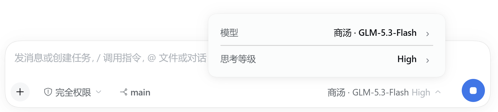
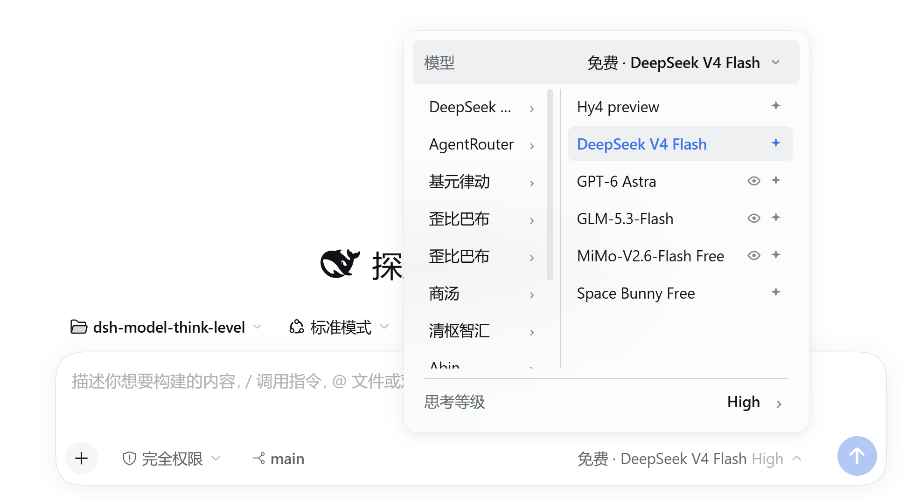
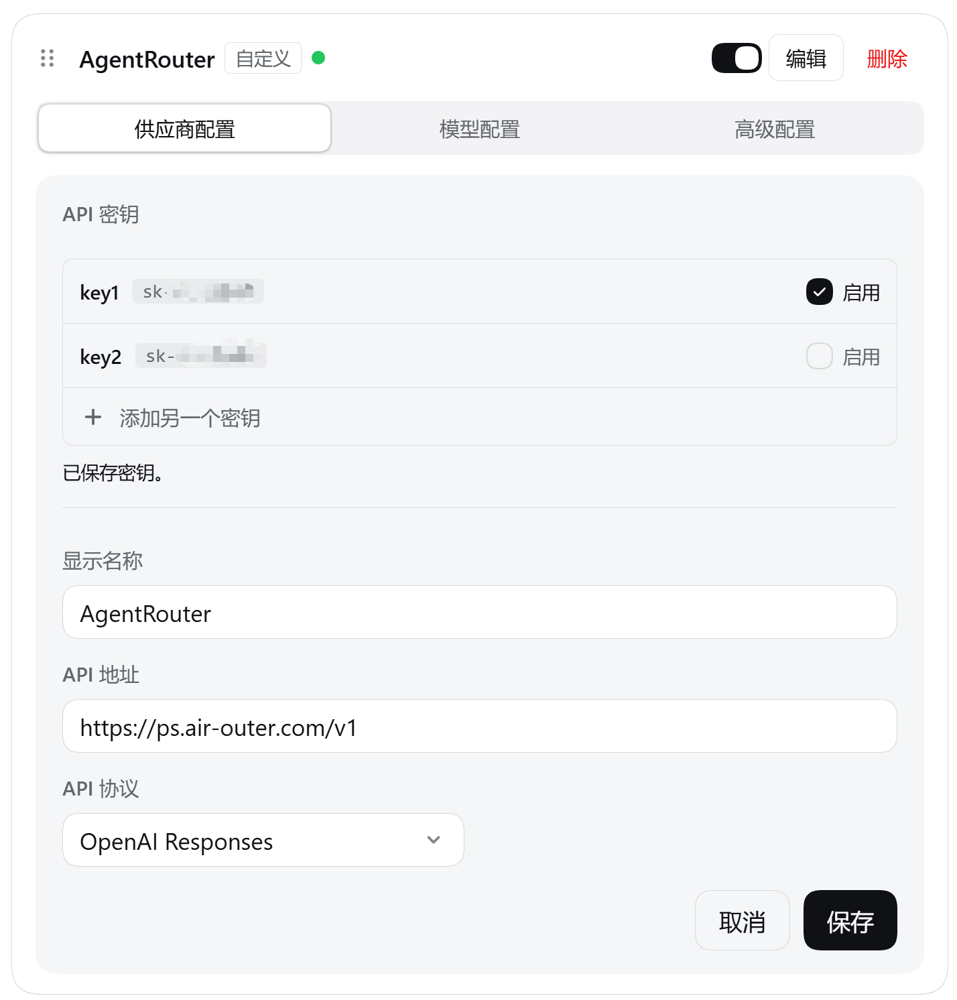
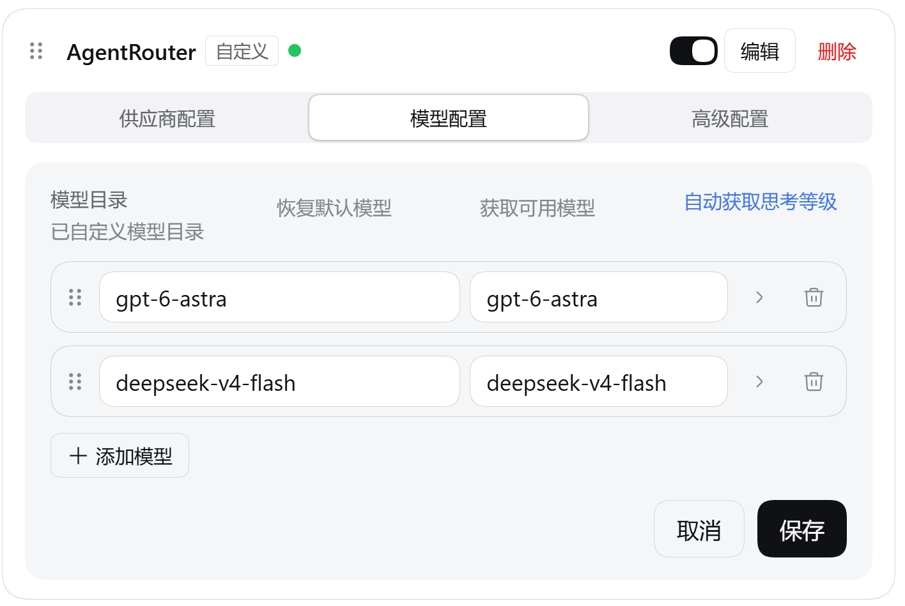
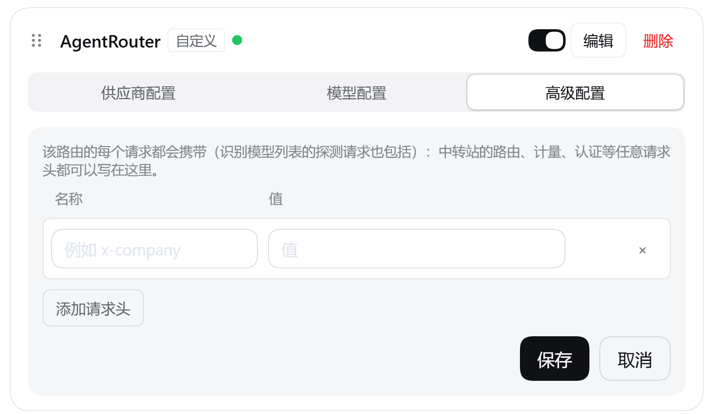

# DSH Model Think Level

[](https://www.npmjs.com/package/dsh-model-think-level)
[](./LICENSE)
[](package.json)

**给 DSH 里的每一个第三方模型补齐思考等级、图片输入与生图能力。**

DSH 自带的 Models 页只认得它自己目录里的模型。中转站、自建网关、聚合 API 上的模型往往没有推理档位、不能声明图片输入、更不能生图；一个供应商只能填一把密钥，配好的请求头还会被适配层自己的归属头盖掉。这个插件把这四件事一次补齐，而且**全部长在官方页面上**——官方的模型页、官方的供应商编辑卡、官方的输入框菜单，只是多出了本来该有的控件，没有第二套设置界面。



## 功能一览

- **思考等级** — 每个模型行一个开关和一份档位表（`off` / `minimal` / `low` / `medium` / `high` / `xhigh` / `max`），每一档都能改真正发出去的取值。输入框菜单里一条滑杆随时切档，也能给新会话定默认档位，不设则跟随记忆。
- **自动识别** — 内置 87 条模型知识库，叠加端点输出模态和模型名启发式，自动补上思考档位、图片输入、上下文容量；容量在模型行右侧显示为 `128K` / `1M`。
- **模型选择器** — 供应商 → 模型两栏、搜索、图片输入徽章、拖拽排序、按供应商启停。只列对话模型，生图模型不进切换器，也不计入模型数。
- **多密钥** — 一个供应商放 N 把密钥，按把启停、按把圈定模型范围、按把指定协议；保存后自动探测每把密钥能服务哪些模型。
- **自动重试** — 401/403/408/429/5xx 和「分组里没有这个模型」自动换下一把密钥，配冷却排序，把还在冷却里的密钥排到最后；请求一旦开始输出内容就不再重放。
- **自定义请求头** — 每个路由可配任意请求头（含 `user-agent`），在 fetch 层按请求重新盖回去；同源冲突、与官方适配器或同类插件的争抢都会被检出。
- **请求伪装** — 每个路由可选 Codex / Claude 两种官方 CLI 身份：客户端请求头，以及 Claude 的 Messages 请求体身份段一并补齐；默认关闭，与自定义请求头同一区块。
- **生图** — 勾一下「生图」就能把任意模型变成生图模型，对话模型调用原生工具 `generate_image` 出图，支持参考图改图、多图并出、默认参数与超时。
- **旧话题恢复** — 换过 Azure 资源/中转账号池的上游会拒收旧话题带来的历史项（`item`）：要么说「created under a different … resource」，要么说某个 `function_call` 缺少与它配对的那条 `reasoning`。打开后同时识别 `400` 响应体与 `200` 流内 `response.failed` 的这些拒绝，在发送副本的消息上下文里逐级去掉旧资源签发的句柄（必要时连历史推理一起），再重放这次请求，不删本地历史。
- **自动继续** — 会话因为断线、超时、撞上输出上限停住时，替你补一条「继续」，可展开配置等待秒数和最多重试次数。
- **余额** — 每个供应商可选配一个只读余额接口，模型页直接显示余额，支持手动刷新。

## 选择模型与思考等级



输入框的模型切换器只列**对话模型**：被标记为「生图」的模型不出现在这里，供应商计数也不含它们。同一个菜单里，模型行下面是思考等级：

- 每个模型行右侧显示已声明的上下文窗口（`128K`、`1M`；`K`/`M`/`B`/`T` 都是简写，也接受纯数字和千分位），留空则不显示。
- 插件编辑器所在的行会隐藏官方自带的「推理等级」编辑区——同一个字段只留一份控件。
- 支持图片输入的模型带视觉徽章；档位表来自模型行配置，也可以点模型页的「自动获取思考等级」让插件补齐。

## 安装

在插件市场里填包名 `dsh-model-think-level` 安装，或者用命令行：

```sh
dsh plugin add dsh-model-think-level
```

从源码安装：

```sh
git clone <repo> && cd dsh-model-think-level
npm ci && npm run build
dsh plugin add .
```

装完重启 DSH。运行环境需要 Node.js `^22.19.0 || >=24`。

## 配置页面

官方供应商编辑卡原本是一根长列表，插件把它改成四个页签：**供应商配置**、**模型配置**、**高级配置**、**指纹检测**。生图的默认参数和自动继续不在卡片里，而在模型页标题行的「高级设置」浮层里。

### 供应商配置：多密钥、地址与余额



**密钥列表。** 官方那把「API 密钥」输入框被换成卡片式列表，每行一把密钥：

- 行首圆点是对勾开关，亮起表示参与路由，灰色表示暂停；停用只把密钥移出分流池，别名、模型范围、协议指定全部保留。行尾是「启用」。
- 「+ 添加另一个密钥」继续加。最后一把启用中的密钥不允许停用——否则请求会回落到适配器自己的单密钥路径，仍然用刚被停用的那把签名。
- 悬停某一行可展开该密钥的**模型**范围：该供应商已添加模型的多选胶囊，留空（「全部模型」）表示不做限制。
- 同一行还能指定这把密钥的**协议**，见下文「按密钥切换协议与多地址」。
- 新建供应商时也可以先攒草稿密钥：点「创建」落库后才真正写入，第一把自动启用；刷新页面丢弃草稿。挂载前已经敲进官方输入框的值留在原处。供应商 id 撞上已存在的供应商时，草稿不会写进对方。

**端点。** 「API 地址」是主地址；「更多端点」里可以按地址家族各配一条：一个 OpenAI 系（Chat Completions / Responses 共用）、一个 Anthropic 系。

**余额。** 「API 地址」下方、「更多端点」展开区里多一行余额：填一个只读的余额接口地址（`http(s)://…`），该供应商在模型页列表的**启用开关前**会显示「余额 12.34」。没填不显示、也不占位；清空地址即撤下。

- 请求由宿主发起（浏览器直连会撞 CORS），带该路由密钥列表里的**第一把**密钥：OpenAI 系协议用 `Authorization: Bearer`，Anthropic 系用 `x-api-key`。多把密钥只查第一把。超时 30 秒，不跟随重定向，密钥只发往填写的地址本身。
- 地址保存在 `key-index.json` 的 `balances` 字段，与协议地址互不覆盖；改完立即生效，不用重启。
- 响应支持 JSON 或纯数字，按键名认余额：`balance`、`total_balance`、`available_balance`、`remaining`、`total_available`、`credit` / `credits`、`amount`、`left`、`remain`、`*_quota`（大小写、下划线、连字符不敏感），同层的 `currency` / `unit` 决定 `$` / `¥`；OpenRouter 风格的 `total_credits` / `total_usage` 按两者之差算。认不出余额按读取失败处理，不显示金额。
- **只在打开模型页时读一次，不轮询**：每次打开、每家读一次；留在页面上不会反复请求；在配置卡里改完地址会立即重读。
- 读取失败（超时、接口报错、认不出余额）时继续显示**上一次成功的金额**；从未成功过才显示「余额 —」，悬停可看宿主返回的原因。行尾刷新图标可以随时手动重取，刷新期间保留当前金额，失败仍沿用旧值。

### 模型配置



- 页签顶部是「模型目录」「恢复默认模型」「获取可用模型」「自动获取思考等级」。
- 每个模型行从左到右：模型名、上下文容量、思考档位编辑入口、输入模态（文本 / 图片 / 生图）。
- **输入模态三档互斥。** 勾「生图」即把模型标记为图像生成模型（写入该行的 `inputImageGen` 标记，同时清掉文本/图片声明），并把它从输入框切换器里隐藏；勾文本或图片则回到普通对话模型。「自动获取思考等级」与后台自动补全同样会识别生图模型：端点的输出模态（如 `output_modalities: ["image"]`）、知识库与模型命名（`gpt-image`、`dall-e`、`flux`、`seedream` 等）都会被打上标记。
- 「获取可用模型」是宿主的一次普通目录读取，插件不替你探测、也不会自动把模型写进供应商：读到的模型进官方勾选列表，你勾选后才写入。插件只是顺带观察每把密钥各自返回了什么，并在多把密钥合并时做一次保守过滤——只有**每一把启用中的密钥都成功给出了目录**、且没有任何一把列出某模型时，该模型不出现在合并结果里（有密钥没读到＝情况未知，不过滤）。

### 高级配置：自定义请求头



一张「名称 / 值」表，加一行就是加一个请求头，`user-agent` 也在这里改。

- 请求头存在官方供应商档案的 `headers` 字典里，换机器、换配置都跟着走。
- 真正生效点在全局 fetch 接缝：**每个请求**都会重新盖一遍，包括列模型、探测这类请求，不只是对话请求。
- `user-agent` 最长 512 字符。
- 冲突会被检出并提示：同源上别的路由已占用同名请求头、官方 `dsh-llm-pi-ai` 的 `transformHeaders` 已经在处理这组头、或者别的同类插件也在写同一个头。

### 高级配置：请求伪装

「请求头」下面是**同一个表单**里的第二个区块：**请求伪装**。默认关闭，按路由保存，可选 **Codex** 或 **Claude**——让该路由的请求以对应厂商官方 CLI 的身份发出，而不是以 SDK 的默认身份。

- 两个区块之间有一条分割线，**取消 / 保存只有一组，放在最下面**：它提交的是整个高级配置（请求头 + 伪装 + 旧话题恢复）。伪装和旧话题恢复都是草稿——点选项只是改了表单，按保存才写入；按取消回到已保存的值。

- 存的是插件自己的文件 `<DSH_HOME>/dsh-model-think-level/camouflage.json`，不写进官方供应商档案；换了版本、删了文件就回到关闭。
- **Codex**：改 `user-agent` 为 `codex_cli_rs/<版本>`，补 `originator: codex_cli_rs` 和一个稳定的 `x-codex-session-id`；请求体不动。
- **Claude**：改 `user-agent` 为 `claude-cli/<版本>`，补 `x-app: cli`、`anthropic-version`、`anthropic-beta`，并在 `/v1/messages` 的请求体里补上校验要看的身份 system 段与 `metadata.user_id`——tools、图片、签名块一律原样保留。请求体的改动会同步重算 `content-length`。
- 与自定义请求头的优先级：伪装先落，**请求头表里的同名项最后生效**——你在表里显式写了 `user-agent`，就以你的为准；`anthropic-version` 只有缺失时才补，已有值保留。
- 只影响这个路由真实发出的请求。探测密钥、余额、生图这类旁路请求不带伪装。

### 高级设置：生图默认参数与自动继续

模型页标题行的按钮打开「高级设置」浮层，目前有两张卡。浮层高度固定（折叠、展开都不变，内容超出时才在浮层内部滚动），两张卡都能点卡片名或右侧箭头展开：

**生图。** 卡片头一行是总开关，默认折叠；展开后：

- 第一行选默认参数：尺寸 / 质量 / 张数，以及**超时**——下拉 5 / 10 / 15 / 30 / 60 分钟，默认 5 分钟。一次调用的凭据读取、参考图读取、参数回退、响应体与图片下载和附件保存共享这个总预算，**重试不重新计时**。
- 第二行用下拉选**默认生图模型**，未设时显示「未设置」。没点名的工具调用就用这里的模型。
- 下面列出所有被标记的模型，每行保留「测试」和「试一张」两个动作；尺寸/质量/张数只在第一行选一处生效。
- 卡片只负责默认值和默认模型，没有独立的工具状态卡；工具注册失败时卡片顶部直接显示宿主给的那句原因（`GET /dsh-model-think-level/image-config` 的 `tool.error`），成功注册不显示任何提示。

**自动继续。** 默认关闭，细节见下文「自动继续」。

<!-- TODO(截图): 这一屏（高级设置：生图 + 自动继续）和「指纹检测」页签还没有截图，补上后插在上面两个小节里。 -->

### 指纹检测

每个检测结果卡可以逐行折叠/展开，默认收起：点行头的箭头或模型名展开，徽章、证据行与检测按钮始终在场。行头只留「N / 3 题」的进度，相似度等明细放在展开的结果卡里。

## 多密钥路由与自动重试

同一个供应商可以登记多把密钥，请求进来时按「模型 → 密钥」自动分流。

**什么时候换密钥。** 密钥按列表顺序排队，一个模型如果多把密钥都能访问，先走靠前的那把。命中这些情况自动换下一把能服务该模型的密钥：

- 状态码 401 / 403 / 408 / 429 / 5xx；
- 响应体说明「这个模型（或这个分组）没有它」——`model_not_found`、`Model "…" is not supported by any configured account in this group`、`no available channel`，以及中文的「模型不存在 / 不支持 / 无可用渠道」。这说的是这把密钥所在的上游分组没有这个模型，换一把可能就有。

**不重试的**：裸 404（如 `404 page not found`）与 400 / 422——这些是请求本身的问题，换密钥也一样，立即返回。全部密钥都拒绝同一个模型时，报错会补一句「这个供应商的全部 N 把密钥都拒绝了模型 X，通常是各密钥所在的分组不同」。

**冷却。** 被拒的密钥记住这次失败，下次请求排到健康密钥后面：

| 情况 | 冷却 |
| --- | --- |
| 响应带 `Retry-After` | 按它说的来 |
| 供应商说模型没有 | 10 分钟 |
| 太频繁 | 60 秒 |
| 额度耗尽 | 30 分钟 |
| 连接被拒 | 60 秒 |

重复失败翻倍并封顶。「模型没有」只冷却**这一对（密钥, 模型）**，同一把密钥的其它模型照常由它服务。冷却只是排序，密钥永远不会被真正丢弃——全体都在冷却时仍按原顺序尝试。

**自动探测各密钥支持的模型。** 供应商保存之后（以及新增/更换密钥、改动端点地址之后），插件在后台按密钥逐把读取它自己的模型目录，写「它列出的模型 ∩ 已添加到该供应商的模型」：能提供全部已添加模型的密钥保持「通吃」不写清单；只提供一部分的写成交集；**一个已添加模型都不提供**的密钥直接关闭（只关这把密钥的行，不动供应商；供应商下密钥少于两把时不做探测）。每次保存和每次点「自动探测」都会重新校准，手动在「模型」表单里改过的清单同样会被覆盖。探测完全在后台，界面上没有中间过程，唯一可见的变化就是结束后密钥上的勾选直接更新；探测只读目录接口，不会用你的模型发请求。被自动关闭的密钥不会自己恢复，需要手动重新开启。

**记住每把密钥的目录读到过什么。** 宿主读目录（模型页「获取模型」）时，插件按密钥逐把读取，结果记在 `key-serves.json`，只用于排序与提示，不写你的清单。规则是「同一供应商下，别的密钥的目录里有这个模型、而这把没有」→ 这把不再作为该模型的候选；只有这一把的目录里有 → 它优先；没有任何密钥列出过（或还没读过）→ 当作未知，照旧都试。某把密钥读取失败＝未知，绝不会被当成「它什么模型都没有」；文件损坏按空处理。

**跨机同步。** 「添加另一个密钥」会优先填回**已经列出、但凭据库里还没有值的引用**，而不是再铸一个新名字：配置从另一台电脑同步过来时，`XXX_API_KEY_2` 在这台还没有值，直接填进去两台的名字就一致了；若改成铸 `XXX_API_KEY_3`，名字会分叉，旧名字还会在面板上留一行「未存储」的残行。填回时别名、模型范围与协议指定都保留（只补值，不改标签）。库里已有值的引用不会被顶掉，那种情况仍然铸新名字。

**插件自己的元数据。** 存在 DSH 数据目录的 `dsh-model-think-level/key-index.json`，只记录引用、别名、模型范围、协议指定、各协议族地址与启停状态，**绝不保存密钥值**（值始终由 DSH 凭据库保管）。供应商暂时读不到、启动时快照不全、或从设置里删除，都**不会自动清除密钥、别名或凭据**——设置里的缺失不能证明用户要删除密钥。要删密钥请在密钥面板显式操作。旧 `routeSweepGraceMs` 配置继续接受，但自动清扫已停用。

每次覆盖前会把上一份有效原文存进同目录的 `key-index.json.history/`，最多 64 份；快照同样只有元数据，不能还原密钥值。旧文件损坏或快照写入失败时拒绝覆盖原文件。同一宿主进程里的不同插件实例、后台范围探测和同步写入器共享同一索引的写入队列；探测拿到队列后重新读索引与供应商设置，已停用的实例不再发布观测或提交范围。凭据写入超时表示结果未知、不代表取消：底层操作结束前仍占着队列，避免迟到删除与下一次填槽交错。这不等于跨进程或跨设备事务，外部同步仍须防丢合并，不能用空列表直接覆盖完整索引。

### 按密钥切换协议与多地址

有些供应商的同一把密钥只在某一种线上协议下可用（例如同一家既有 OpenAI Chat Completions 端点、又有 Anthropic Messages 端点），插件支持给每把密钥单独指定协议：

- 「这个密钥可用的协议」默认「自动（按模型）」：每个请求按模型自己所属的协议族挑线路——claude 系走 Anthropic 地址（前提是供应商配了该族地址），其余模型沿用供应商自身协议。也可指定 `Anthropic` / `Chat Completions` / `Responses`；菜单只列供应商已配过地址的那些档，已钉的档即使地址后来被清掉也保留显示，选「自动」即解除指定。
- 指定之后请求会真正换用对应的线上协议——不只是换 URL 和鉴权头，请求体也按该协议重新编码，由插件在 pi-ai 适配层重新派发给 `@earendil-works/pi-ai` 的对应实现。
- 密钥指定的协议跨了地址家族（OpenAI 系 ↔ Anthropic 系）而供应商**没有**该家族地址时，这条指定不生效：请求仍用供应商自身的协议和 `baseURL`，只由这把密钥签名。把 OpenAI 格式的请求体发到 Anthropic 地址只会换来网关的 `404`/`400`（模型根本不会被调用），所以宁可不换。每次调用都重新判定，供应商地址补上后同一个模型立刻换线；「自动」档同理，某族没地址就回落到供应商自身协议。
- 自动挑错线路有记忆：某族地址对一个模型返回了「还没产生内容就失败」（典型如网关 404）后，这个（供应商, 模型）组合的自动解析不再挑那一族，改用供应商自身协议，直到进程重启；成功过的线路也会被记住并优先使用。钉选协议的密钥不受这层记忆影响——钉选表达的是明确意图，失败只说明凭据问题。
- 两把密钥指定了不同协议（或自动档解析出不同协议）时，先试哪把不再取决于列表顺序，而是按「这个模型看起来属于哪一族」排：模型名（含 `anthropic/`、`openai/` 这类前缀或裸名；族名记号 `claude`、`gpt`、`codex` 后跟 `-` / `/` / `:` / `.` / `_` 分隔符或位于名字结尾才算）与密钥协议家族一致者优先，其次是以本密钥自身地址就能直接服务的，再次是不一致但能回落到供应商主地址的，最后是跨族且没有自己地址的。请求从排第一的密钥的协议开始——切协议意味着换请求体形状，一次只切一把密钥，失败后按此顺序换下一把。
- 同一协议（wire）的密钥当作一个池：先把这个池用完再换 wire，因为同一把密钥失败通常与协议无关。跨 wire 的切换排在池之后，且只有在上一次失败的请求还没开始产生内容时才做。
- 请求进行到一半再失败（已经开始流式输出、或调用方已主动取消）不会触发换密钥——客户端已经消费了已发出的内容，重放只会产生重复输出。

### 不再支持 Gemini 原生协议

旧的 `google-generative-ai` 密钥协议指定会按无效值回到「自动」，旧的 `gemini` 端点字段在读取时被忽略，并在下次保存密钥索引时移除。模型知识库里的 Gemini 思考档位仍保留，供支持 OpenAI 兼容协议的网关使用；不会根据 Gemini / Gemma 模型名自动切到原生协议。若供应商主协议曾被手工设成 `google-generative-ai`，仍需改回宿主支持的协议并填上兼容地址——插件不会自动改写宿主的供应商配置。

## 生成图片

先按「模型配置」里的做法把模型的输入模态勾成**生图**（或在「高级设置」里设好默认生图模型），然后对话模型就能出图了。

**没有中间层。** 插件不拦对话、不解析回复里的图片标记。它把 `generate_image` 注册成宿主进程里的原生工具——不走 MCP，装完不用额外起进程；名字被占时自动改名为 `dsh_image_generate` 并在日志里说明。

生图工具、会话提示、`/生图` 命令和配置页每次都从宿主当前运行的模型设置读取同一份模型列表；不依赖打开配置页、固定延时或后台同步事件。新增、删除模型或更换连接会在下一次读取时生效，单次生成固定使用开始时取得的配置。

宿主设置尚未运行、正在重载或读取失败时，会明确报告「生图配置暂不可用」；设置已经就绪但没有生图模型时，会明确报告「没有标记为生图的模型」。这两种状态都不会继续沿用旧模型列表。前端不缓存空列表或错误，恢复后下一次请求即可重新读取。

参数：`prompt`（必填）、`model`、`size`、`quality`、`n`、`reference_images`（本地路径）、`reference_attachments`（对话内图片的附件 ID，`sha256:…` 或裸摘要均可，两者可混用）、`path`（落盘位置）。任何参考图非空即走 `/images/edits`。

- 多图：上游按 `n` 返回的每一张都会落盘、存为附件并全部附到对话（上游少给就少收，不会编造）。
- 助手最终回复：工具描述、会话系统提示与成功结果都要求助手**逐张把图片直接嵌进最终回复**，不能只说「已生成」或依赖工具卡片。成功结果给出的是真实落盘路径、可直接复制的 Markdown 嵌图语句，Windows 路径转成 `/`，含空格的路径用尖括号包裹。
- 工具卡片按 `generate_image` 这个名字立刻注册，之后宿主报了别的名字（撞名回落）再跟着改名，所以不依赖「页面打开时工具已经注册成功」；但前端 bundle 只在页面加载时取一次，装完或升级完要**刷新页面**（或重开窗口）才会加载新代码。
- 文本对话模型收到图片结果时会自动降级成一行占位文本（宿主行为），所以**对话模型不需要声明图片输入**也能安全调用；图片始终在对话卡片里可见。
- 超时或停止会结束插件自己的等待，并向支持取消的依赖传递信号；忽略信号的外部操作或已被上游接受的生图任务不保证撤销，同步解码/文件操作也不能被抢占。热重载只更新后续调用，不替换已经在跑的旧调用。
- 从 2.0.3 及更早版本升级：启动时会自动移除旧版「生图 MCP」在 `cordis.patch.yml` 里留下的条目（带 `.bak` 备份），重启后旧的 `dsh-image` MCP 服务不再被拉起。带旧版标记注释的块和没有标记的裸 `- insert:` / `- id: dsh-image-mcp` 条目都能清掉；同一块里还插着别人的插件条目时不动它。

## 旧话题恢复

同一个供应商如果换过 Azure 资源、换过中转账号池，旧话题的下一条消息可能直接被拒。会见到两种说法：

```
The requested item was created under a different Azure OpenAI resource. Use the same resource that created the item to access it.
```

```
Item 'fc_04e5…' of type 'function_call' was provided without its required 'reasoning' item: 'rs_04e5…'.
```

前者是历史项的标识属于上一个资源；后者是同一次拆分的结果——中转把工具调用的 `fc_` 句柄留下了，却没把与它配对生成的那条 `rs_` 推理项一起重放，服务端按配对关系找不到兄弟项。**两者是同一件事：重放的历史和服务它的后端对不上。** 旧话题的历史项带着上一个资源签发的标识和加密推理，新资源不认识它们。这不是密钥失效，也不是模型不存在——换密钥、切协议、把话题清空重来都不对症，而且本地那段历史还在，换个入口发出去照样被拒。

「高级配置」里的第三块**旧话题恢复**就是为这两种拒绝准备的，默认关闭，按路由打开：

- **认措辞，不认状态码**：这两种拒绝都可能以 `400` 出现（正文是 JSON，或中转把 400 当 SSE 流发回来），也可能以 `200` 的流内 `response.failed` 出现——流式 Responses 更常见的正是后者。两种都会识别，因为恢复引擎读的是那句精确措辞，而不是 HTTP 门牌。别的错误一律原样透传。
- **在原消息上下文上降级，逐级放宽**：第一次原样发送；命中后先只去掉重放历史里绑定旧资源的句柄——推理项 `thinkingSignature` 里的 `id`、文本项 `textSignature` 里的 `id`、工具调用 `id` 里的 `itemId` 半段（去掉它，被拆开的 `fc_`/`rs_` 也就不再触发配对校验）；仍被拒就再停止重放历史推理（本地可见的思考文本不动）。恢复只发生在流还没把任何内容交给调用方之前；已经开始输出的回合不会被重放。
- **不动你保存的历史**：只改这一次请求的副本。`call_id`、工具调用与结果的配对、正文、顺序、`previous_response_id` 全部保留；`item_reference`、compaction 这类带密文的项不碰。
- **不牵连密钥与协议**：恢复在同一个候选密钥、同一个地址、模型和协议内完成；历史类失败不会把密钥记进冷却、不算协议失败、不触发自动继续。修不好时不换密钥——每把密钥都到同一个中转池，换只是把同样的失败多试几遍。
- **代价很小**：只有匹配到那句拒绝时才多读一次错误体（上限 64 KiB / 2 秒），或按需多跑一至两次降级重放；正常请求一个字节都不多看。

打开后仍报同一句错，说明上游还要别的项一起换（例如 compaction 或 `previous_response_id`），插件不会盲删这些密文——换回原资源，或开一个新话题继续。

## 自动继续

会话偶尔会因为断线、超时、输出达到上限停在半路，需要手动回一句「继续」才能跑完。「高级设置」里的**自动继续**默认关闭：点击名称或箭头展开配置，右侧开关控制是否启用。

- **只继续「断在半路」的回合**：回合因传输错误（断线、流中断）、超时、5xx、限流、空响应而失败，或输出撞到令牌上限（`max-tokens`）时才自动发送；正常完成、你手动停止的回合、等待你审批或回答的回合一律不动。
- **修不好的错误不重试**：鉴权失败（401/403）、额度耗尽、请求无效（400/413）、上下文超长都不会触发继续——再发一条「继续」也无济于事。
- **失败后等待多久、最多重试几次可配置**：默认失败后等待 2 秒、连续最多重试 5 次；等待时间可设为 1–3600 秒，重试次数可设为 1–100 次。输入整数后离开输入框或按 Enter 即保存，折叠、关闭开关和刷新页面都保留设置。每次失败后都先等这么久再发送「继续」，给限流留出冷却时间；上游 `Retry-After` 更长时按上游来（最多计入 2 分钟），不会缩短你设置的更长等待。你手动发送任何消息、或模型正常跑完一个回合，计数清零；等待期间手动发送消息或关闭开关会取消待发送的继续。
- **只看当前会话、只认亲眼所见的结束**：页面加载时历史里已有的失败不会被补发；切到别的会话后，原会话的失败也不再追发。发送前会再次确认回合确实已结束、你没有正在排队的新消息。
- 自动回复以一条普通用户消息（「继续」/ "Continue"）出现在对话里，与手打的没有区别；多个标签页同时开着时，同一次中断只会有一个标签页发送。
- **输入框下方有本会话的控制器**：会话统计栏最右侧（`◔ 10%` 右边）只在自动继续进行中显示一枚胶囊，形如「第 2/5 次 · 21s」并带「停止」；点开可「立即继续 / 停止 / 设置…」。**会话里的操作只作用于本会话**：「停止」结束这条链并让胶囊消失，你在本会话再发一条消息后才会重新接管、且从第 1/5 次重新计数；自动继续正常跑完也会立刻收起，不留常驻条。全局开关与等待/次数/错误类型仍在设置页。详见 [docs/auto-continue-error-policy](docs/auto-continue-error-policy/README.md)。

## 数据文件

都在 DSH 数据目录的 `dsh-model-think-level/` 下：

| 文件 | 内容 |
| --- | --- |
| `key-index.json` | 密钥引用、别名、模型范围、协议、端点、启停状态、余额地址；**不含密钥值** |
| `key-index.json.history/` | 上面那份元数据的自动快照，最多 64 份 |
| `key-serves.json` | 自动探测得到的「哪把密钥能服务哪个模型」，只用于排序与提示 |
| `ui-order.json` | 供应商与模型的顺序、启用开关，供多机同步；不含任何秘密 |
| `camouflage.json` | 每个路由的请求伪装身份；只记开着的那几条 |
| `topic-recovery.json` | 每个路由是否启用旧话题恢复；只记开着的那几条 |
| `image.json` | 生图开关、默认模型与参数、输出目录及连接对应的诊断；不存可执行的模型列表 |

生图偏好文件使用版本 3。旧版本首次保存偏好或记录生成结果时才迁移，原文保留为 `image.json.v2.bak`；读取、显示提示和打开配置页均不改写文件。旧文件中的模型只用于迁移诊断，不能代替宿主当前模型设置。文件损坏或不可读时会保留原文件并明确报错，不会静默重置。

`camouflage.json` 和 `topic-recovery.json` 只有路由名与开关，没有秘密，也已在包的 `dsh.webdavSync.configFiles` 里声明，启用 dsh-webdav 的「已安装插件」后会随插件配置同步。文件名刻意不带 `history`：同步层把 `history` 段当会话历史，带这个词的文件一律不带走。旧版写下的 `history-compat.json` 不会被丢，第一次读取时自动迁移成 `topic-recovery.json`。

`ui-order.json` 的同步规则：页面上的实时状态在 localStorage，插件在后台防抖写这个文件，按「最后写入者胜」与本地状态对齐（文件更新就采纳文件，本地更新就回写文件）。采纳文件里的停用集合时会**写回 localStorage**，所以刷新、重开浏览器之后仍是文件那一份，不会出现「这台机器看着同步好了、一刷新又变回去并把它推回文件」。每次改动拿到严格递增的时间戳，重启后同一毫秒内的多次改动也不会互相覆盖；文件比本页新时立即采纳，本页时间戳不更新时**拒绝写入**（服务器回 409 并把赢得的那份带回来），旧标签页不会把别人的新顺序回滚。页面每分钟、以及切回标签页/窗口获得焦点时重新拉取一次，另一台电脑的改动不用重启就能出现。文件里只有供应商路由、模型 id 和停用名单，不含任何密钥，可以放心交给同步盘。

## 兼容与已有配置

1.1.4 起不再提供 `thinkingTokenBudgetField`、`vllmPriority`、`supportsMaxOutputTokens` 的专用编辑控件。已有值仍由 DSH 的 pi-ai 适配器使用；修改模型的思考档位或输入模态时，插件会保留这些值和其他手动兼容配置，避免覆盖供应商的定制行为。

需要调整旧值时，先备份当前 profile 的 `cordis.patch.yml`（在 DSH 数据目录的 `profiles/<profile>/` 下），找到 `llm-pi-ai` 对应供应商、模型行的 `compat`，只改需要改的字段，保存后重新加载该 profile：

- `thinkingTokenBudgetField`：令牌预算的请求字段名，可取 `thinking_token_budget`、`thinking_budget` 或 `thinking_budget_tokens`。删掉后使用默认字段；启用令牌预算的模型在后续适配或保存时可能重新补入 `thinking_token_budget`。端点不支持令牌预算时，把 `supportsThinkingTokenBudget` 设为 `false`。
- `vllmPriority`：删掉后不再发送定制的 vLLM 优先级。
- `supportsMaxOutputTokens`：删掉后恢复适配器默认行为；保留 `false` 会继续关闭对应输出令牌参数。

不要删除整个供应商配置，也不要把包含 API key 的配置文件贴到公开 issue。

## 开发与验证

使用 Node.js `^22.19.0 || >=24`。依次运行 `npm ci`、`npm run typecheck`、`npm test`、`npm run build`、`npm run check:package`。测试最多并行 4 个 worker，控制 DOM 测试的内存占用；仍用 Vitest 默认超时。

`check:package` 检查 npm 实际打包清单里的入口、截图和声明文件依赖——`files` 里每一项都必须命中文件，README 里的每张相对路径图片和 `screenshots.json` 里的每一张都必须真的在包里。CI 与发布流程都会执行。类型声明引用的 DSH 可选 peer 由宿主开发环境提供，不会自动安装额外宿主插件。

更新模型知识表后，可运行 `npm run docs:models` 生成可查阅的模型列表。`node scripts/wire-repro.mjs` 用当前安装的 pi-ai 向本地回显服务发测试请求，不需要供应商凭据。
